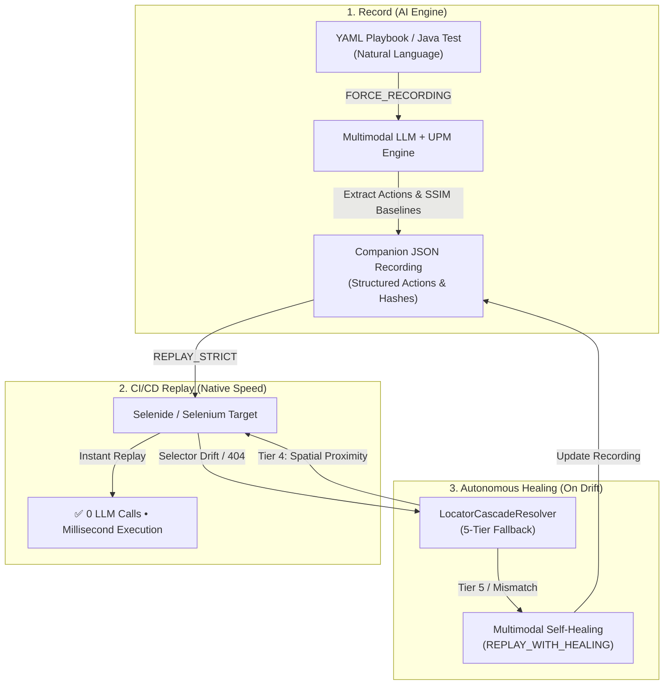

[](https://mvnrepository.com/artifact/com.xceptance/neodymium-library)

# Neodymium

**Neodymium** solves modern web test automation challenges by assembling state-of-the-art open-source libraries — **JUnit 5 / JUnit 4**, **Selenium WebDriver**, **Selenide**, **BDD/Cucumber**, and **Allure Reporting** — into a cohesive, rock-solid framework with the missing glue code built right in.

Instead of hand-crafting brittle browser drivers, boilerplate waits, or disconnected reporting scripts, Neodymium provides ready-to-run project templates, intelligent abstractions, and seamless multi-browser execution matrices out of the box.

Today, Neodymium offers two complementary ways to build and run test automation:

1. **Neodymium Classic (Zero AI)**: Pure, reliable, code-first test automation in Java under the permissive MIT license.
2. **Neodymium AI**: Next-generation multimodal AI test automation, natural language playbooks, autonomous self-healing, and a standalone No-Code Web UI.

📚 [**Official Documentation**](https://docs.xceptance.com/neodymium) • 📖 [**Technical Architecture Manual**](doc/DOCUMENTATION.md) • 💬 [**Commercial Support**](mailto:support@xceptance.com)

---

## 🏛️ Ecosystem & Subproject Directory

Neodymium is organized as a multi-module Maven monorepo. Each subproject is self-contained and documented with its own dedicated guide:

| Subproject | Directory | Role & Key Capabilities | Paradigm | License |
| :--- | :--- | :--- | :--- | :--- |
| **Neodymium Archetype** | [`neodymium-archetype/`](neodymium-archetype/README.md) | Turnkey Maven starter template to bootstrap ready-to-run projects in seconds. | Quickstart | GNU AGPLv3 + Commercial |
| **Neodymium Classic** | [`neodymium-classic/`](neodymium-classic/README.md) | Mature, code-first Java automation (Selenide, JUnit 4/5, Page Objects, BDD). | Traditional (No AI) | MIT License |
| **Neodymium Core** | [`neodymium-core/`](neodymium-core/README.md) | AI engine, Java AI tests, natural language playbooks, UPM, and self-healing. | AI-Powered | GNU AGPLv3 + Commercial |
| **Neodymium AI Manager** | [`aura-manager/`](aura-manager/README.md) | Interactive local Web UI for visual playbook authoring, live runner, and reporting. | No-Code UI | GNU AGPLv3 + Commercial |
| **Neodymium Test Server** | [`neodymium-test-server/`](neodymium-test-server/README.md) | Embedded Javalin server hosting the VÉRLA demo store and AI Glance sandbox. | Test Fixtures | GNU AGPLv3 + Commercial |
| **Neodymium E2E Tests** | [`neodymium-e2e-tests/`](neodymium-e2e-tests/README.md) | Comprehensive integration suites, SUT benchmarks, and Maven test profiles. | Test Harness | GNU AGPLv3 + Commercial |

---

## 🚀 Choose Your Approach

### Path A: Bootstrap a New Project (Turnkey)

The fastest way to get started is by generating a fresh test suite with `neodymium-archetype`:

```bash
mvn archetype:generate \
  -DarchetypeGroupId=com.xceptance \
  -DarchetypeArtifactId=neodymium-archetype \
  -DarchetypeVersion=6.0.0-BETA \
  -DgroupId=com.example \
  -DartifactId=my-test-suite \
  -DinteractiveMode=false
```

The generated project comes pre-configured with dependencies, sample playbooks, JUnit test runners, configuration files, and the bundled No-Code UI startup scripts.

👉 *Read more in the [Neodymium Archetype Guide](neodymium-archetype/README.md).*

---

### Path B: Traditional Java Testing (Zero AI)

If your team wants proven, programmatic test automation in Java without any LLM APIs, tokens, or AI dependencies, use **Neodymium Classic**:

```xml
<dependency>
    <groupId>com.xceptance</groupId>
    <artifactId>neodymium-classic</artifactId>
    <version>6.0.0-BETA</version>
    <scope>test</scope>
</dependency>
```

```java
import static com.codeborne.selenide.Condition.visible;
import static com.codeborne.selenide.Selenide.$;
import static com.codeborne.selenide.Selenide.open;

import com.xceptance.neodymium.common.browser.Browser;
import com.xceptance.neodymium.junit5.NeodymiumTest;

@Browser("Chrome_1024x768")
public class StorefrontClassicTest
{
    @NeodymiumTest
    public void testHomepage()
    {
        open("https://www.xceptance.com");
        $("#navigation").shouldBe(visible);
    }
}
```

👉 *Read more in the [Neodymium Classic Guide](neodymium-classic/README.md).*

---

### Path C: AI-Powered Automation (Playbooks & Java AI)

If you want to author tests in plain natural language or combine Java with AI perception, use **Neodymium Core**. The AI records resilient element locators and visual baselines once; subsequent CI/CD runs replay in milliseconds with **zero LLM API calls** and automatically heal when the UI drifts:



```java
@NeodymiumAiTest
public class StorefrontQuickstartTest
{
    @AiMode(ExecutionMode.REPLAY_WITH_HEALING)
    @AiInlinePlaybook("""
        steps: |
          Open ${baseUrl}/store/index.html in the browser
          Type "${query}" into the search bar and press enter
          Click on the first product card in the results
          Click the "Add to Cart" button
          Verify that the cart badge displays "1"
        data:
          - baseUrl: "https://demo.neodymium.org"
            query: "Minimalist Watch"
        """)
    public void testAddToCart(final AiSession session)
    {
        // NeodymiumAiRunner executes the playbook automatically!
    }
}
```

👉 *Read more in the [Neodymium Core Guide](neodymium-core/README.md).*

---

### Path D: No-Code Web UI (Neodymium AI Manager)

For visual playbook authoring, drag-and-drop step assembly, streaming execution logs, and interactive Allure reporting without touching code, launch the local Web UI:

```bash
# Linux / macOS
./run-neodymium.sh

# Windows
run-neodymium.bat
```

Open your browser at `http://localhost:8080/` to access the interactive dashboard.

👉 *Read more in the [Neodymium AI Manager Guide](aura-manager/README.md).*

---

## 🏗️ Monorepo Developer & Build Guide

### Prerequisites
* **Java Development Kit**: JDK 21 or higher
* **Apache Maven**: Version 3.9+

### Reactor Build Commands

* **Compile the entire monorepo:**
  ```bash
  mvn clean compile
  ```
* **Install all modules locally (skip tests & javadocs):**
  ```bash
  mvn clean install -DskipTests -Dmaven.javadoc.skip=true
  ```
* **Target a specific subproject (and required dependencies):**
  ```bash
  # Core AI engine
  mvn test -pl neodymium-core

  # Classic framework
  mvn test -pl neodymium-classic

  # Run standalone test server
  mvn exec:java -pl neodymium-test-server

  # Run AI Manager
  mvn spring-boot:run -pl aura-manager
  ```

### Contributor Test Execution

When contributing to Neodymium or testing local engine modifications:
* Run fast in-memory unit tests: `mvn test -pl neodymium-core -Punit-tests`
* For the full suite of internal integration and regression profiles, see the [Maven Test Profiles Guide](doc/TEST_PROFILES.md).

---

## 🔗 Quicklinks & Demos

* [**Documentation Portal**](https://docs.xceptance.com/neodymium): Complete user guide and migration notes.
* [**Neodymium Template**](https://github.com/Xceptance/neodymium-template): Quickstart project template for Java and Cucumber.
* [**Neodymium Pure Java Example**](https://github.com/Xceptance/neodymium-example): Reference test suite against the Posters demo store.
* [**Neodymium Cucumber Example**](https://github.com/Xceptance/neodymium-cucumber-example): BDD-driven test suite.
* [**Neodymium Showcase**](https://github.com/Xceptance/neodymium-showcase): Code snippets demonstrating individual features.
* [**Neodymium Wiki**](https://github.com/Xceptance/neodymium/wiki/): Classic wiki and historical documentation.

---

## 📄 License

Neodymium operates under a dual-licensing model based on module boundaries:

### 1. Neodymium Classic — MIT License
The classic test automation framework ([`neodymium-classic`](neodymium-classic/README.md)) is fully open-source and licensed under the permissive **[MIT License](LICENSE#section-a-mit-license-neodymium-classic)**. You are free to use, modify, distribute, and commercially host Neodymium Classic without restriction.

### 2. Neodymium AI — Dual-Licensed: GNU AGPLv3 + Commercial
The next-generation AI automation framework ([`neodymium-core`](neodymium-core/README.md), [`aura-manager`](aura-manager/README.md), [`neodymium-test-server`](neodymium-test-server/README.md), [`neodymium-e2e-tests`](neodymium-e2e-tests/README.md), and [`neodymium-archetype`](neodymium-archetype/README.md)) is **dual-licensed** to support both open-source developers and enterprise deployments:
- **Community Edition (GNU AGPLv3):** Free for development, testing, and internal applications under the **[GNU Affero General Public License (AGPLv3)](LICENSE#section-b-gnu-affero-general-public-license-neodymium-ai)**.
- **Commercial Edition:** For hosted SaaS offerings, commercial bundling, proprietary integrations, or enterprise usage without AGPLv3 copyleft/network-disclosure terms, a **[Commercial License](LICENSE#section-c-commercial-license-neodymium-ai)** is required.
- **Commercial Support & Inquiries:** Contact **[support@xceptance.com](mailto:support@xceptance.com)**.

---

## 🏢 About Xceptance

We are [Xceptance](https://www.xceptance.com/en/) — software testing experts specializing in digital commerce and test automation. We also develop [Xceptance Load Test (XLT)](https://github.com/Xceptance/XLT), an open-source performance testing tool.

---

*This document was generated with the assistance of AI and reviewed by Xceptance experts.*
