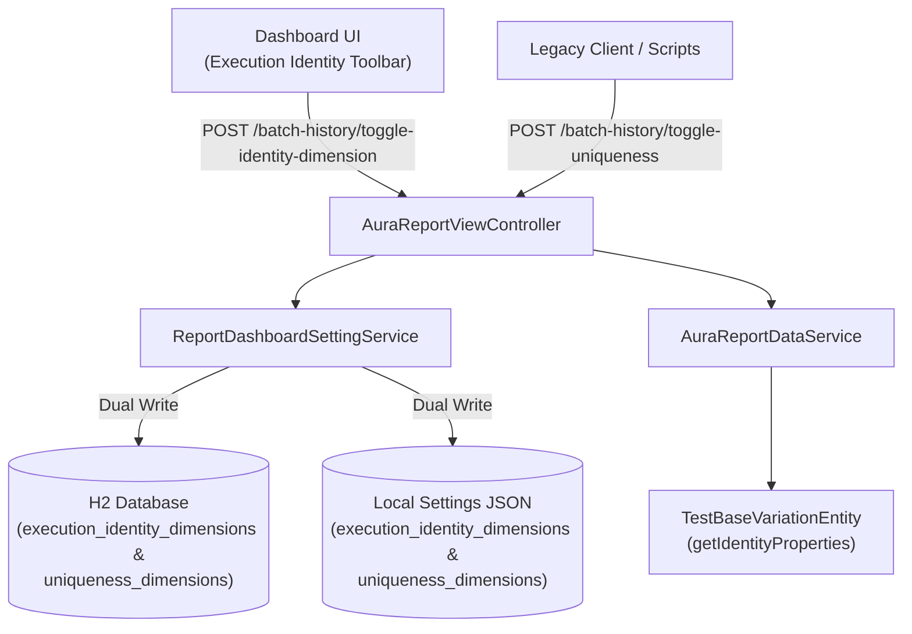

# [IDEA-20261028-1505] Execution Identity Refactoring (Replacing "Definition of Uniqueness")

- **Status:** `Implemented`
- **Proposed:** 2026-10-28 15:05
- **Resolved:** 2026-10-28 15:15
- **Component:** `aura-manager`
- **Category:** `Architecture & Core`
- **Author:** Xceptance Neodymium Team

## 1. Problem Statement & Motivation
In automated test reporting and test management within Neodymium Aura, tests executed across multiple environments, browser configurations, locales, or custom metadata tags must be tracked and aggregated over time.

Previously, the dashboard referred to the configurable dimension set used for this grouping as the **"Definition of Uniqueness"** (with associated toolbar labels such as *"Uniqueness:"* and settings keys like `uniqueness_dimensions` and `variations_apply_uniqueness`). In software quality engineering and test automation, however, "uniqueness" has an established, conflicting meaning: locator uniqueness (e.g. `findElements().size() == 1` vs ambiguous element selectors) or unique constraint validation.

Using "uniqueness" to describe the composite key dimensions (Test Class + Method + DataSet + Browser + [Environment/Tags]) was confusing to users and developers alike. In reality, these dimensions define the **Execution Identity**—the distinct identity of a test execution instance across multiple batch runs.

## 2. Proposed Architecture & Design
Rename "Definition of Uniqueness" to **"Execution Identity"** across all layers of `aura-manager` while guaranteeing seamless 100% backward compatibility for existing configurations, stored preferences, HTMX endpoints, and Java API callers.

### Architectural Breakdown
1. **Naming Standard:**
   - UI Toolbar: `Execution Identity:` (container `#batchExecutionIdentityToolbar`, class `.execution-identity-bar`).
   - UI Checkbox: `Apply identity dimensions` (`#chkApplyIdentityToVariations`).
   - Core Service Methods: `getExecutionIdentityDimensions()`, `setExecutionIdentityDimensions()`, `toggleExecutionIdentityDimension()`, `isExecutionIdentityDimensionActive()`, `isVariationsApplyIdentity()`, `setVariationsApplyIdentity()`, `toggleVariationsApplyIdentity()`.
   - Settings Keys: `execution_identity_dimensions` and `variations_apply_identity`.
   - Controller Endpoints: `/batch-history/toggle-identity-dimension` and `/batch-history/toggle-variations-identity` (with `/runs/*` equivalents).
   - Entity Methods: `TestBaseVariationEntity#getIdentityProperties()`, `setIdentityProperties()`, and `getIdentityProperty(key)`.

2. **Dual-Read / Dual-Write Backward Compatibility:**
   - Stored Settings: When reading identity dimensions, `ReportDashboardSettingService` reads `execution_identity_dimensions`; if absent, it falls back to reading the legacy `uniqueness_dimensions` key before applying the default `["browser"]`. When persisting, it writes both keys to ensure old tools/scripts reading the database or local JSON file remain functional.
   - HTTP Endpoints: Old endpoints (`/batch-history/toggle-uniqueness`, `/batch-history/toggle-variations-uniqueness`) route to the same controller methods.
   - Model Attributes: Controllers populate both `applyIdentityToVariations` and `applyUniquenessToVariations` (and their respective custom tag lists) so any legacy Thymeleaf templates or plugins continue to evaluate without errors.
   - Java API: All legacy `*Uniqueness*` methods in `ReportDashboardSettingService`, `AuraReportDataService`, and `TestBaseVariationEntity` are marked `@Deprecated` and delegate directly to their `*Identity*` replacements.

## 3. Expected Impact & Trade-offs
- **Benefits:**
  - Precision and Clarity: Accurately conveys that the selected tags and properties constitute the composite primary key (identity) of a test execution across time.
  - Zero Breaking Changes: Full backward compatibility across API delegates, HTMX endpoints, and database/file persistence layers.
  - Enhanced User Experience: Clean, professional UI terminology with clear visual distinction from DOM element locator uniqueness.
- **Risks & Complexity:**
  - Dual persistence overhead: Writing both settings keys adds minimal overhead during preference updates (which occur infrequently upon user interaction).
  - Deprecated method maintenance: Deprecated methods must be kept until the next major version release.

## 4. Open Questions & Alternatives Considered
- **Alternatives Evaluated:**
  - *Option 1: "Execution Identity"* (Selected): Best captures the composite identity of a test variation across execution tracks.
  - *Option 2: "Signature Dimensions"* or *"Variation Identity"*: Rejected as slightly less intuitive for QA engineers configuring batch trend reports.
  - *Option 3: "Logical Key Criteria"*: Rejected as overly generic and database-centric for a user-facing dashboard.
