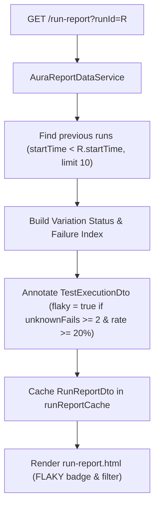

# [IDEA-20261030-1602] Flaky Tests Detection & Reporting

- **Status:** `Implemented`
- **Proposed:** 2026-10-30 16:02
- **Resolved:** 2026-10-30 16:15
- **Component:** `aura-manager`
- **Category:** `Reporting & Test Intelligence`
- **Author:** Xceptance Neodymium Team

## 1. Problem Statement & Motivation
In automated test suites, flaky tests—tests that fail intermittently due to race conditions, timing issues, or environment glitches rather than verified SUT bugs—erode confidence in automation results.
Previously, Neodymium Aura's reporting dashboard presented each test execution with only its immediate run status (`PASSED`, `SUCCEEDED_FIXED`, `FAILED_KNOWN`, `FAILED_UNKNOWN`, `SKIPPED`). Users had to manually inspect the execution history of every test variation to identify tests that frequently fail without an associated bug ticket.

There was no automated mechanism to detect or visually mark flaky tests on run reports or across the Test Base.

## 2. Proposed Architecture & Design
Mark flaky tests on reports by identifying tests that failed often in previous runs due to unknown failures (`FAILED_UNKNOWN`).

### Architectural Breakdown
1. **Flakiness Definition & Criteria**:
   - **Target Status**: Only unknown failures (`FAILED_UNKNOWN`, `failed-unknown`, `failed`, `error` without bound bugs). Known bugs (`FAILED_KNOWN`) are excluded as they represent confirmed defects.
   - **Scope of Previous Runs**: All completed test runs occurring prior to the current run ($r.\text{startTimeMs} < \text{current}.\text{startTimeMs}$), bounded by a sliding historical window (default: last 10 previous runs).
   - **Frequency Criteria**:
     - Minimum unknown failures $\ge 2$.
     - Minimum failure rate $\ge 20\%$ in previous runs within the window.
2. **Single-Pass Efficient Evaluation**:
   - `AuraReportDataService` precomputes historical variation unknown failure frequency across candidate previous runs in a single pass ($O(1)$ lookup per test execution).
   - Populates `flaky`, `flakyFailureCount`, `flakyTotalRuns`, and `flakyReason` on `TestExecutionDto` and `TestBaseVariationEntity`.
3. **Multi-Level Report Presentation**:
   - **Run Report (`run-report.html`)**:
     - Execution table: Distinct `FLAKY` amber badge displayed in the Status column alongside execution status (`[PASSED] [FLAKY]`, `[UNKNOWN FAIL] [FLAKY]`).
     - Filter toolbar: Clickable `Flaky: <count>` badge in `#wholeExecutionSummaryBadges` allowing one-click filtering for all flaky tests.
     - Side panel inspector (`side-panel-step-list.html`): Header badge and contextual warning banner detailing the historical failure count.
   - **Test Base (`test-base.html`) & Batch History (`batch-history.html`)**:
     - Shows `FLAKY` pill on test variations exhibiting recurring unknown failures.
   - **JavaScript Filtering (`report-manager.js`)**:
     - Updated `applyFilter()` and `applyRunReportFilters()` to support `data-flaky="true"` matching when filtering by `FLAKY`.

## 3. Expected Impact & Trade-offs
- **Benefits:**
  - Instant visibility into unstable/flaky tests without manual drill-downs.
  - Transparent reasons with exact failure frequencies in tooltips and side panels.
  - Zero performance degradation via cached, single-pass indexing.
- **Risks & Complexity:**
  - Need to ensure historical cache is invalidated when runs or bugs are modified (already handled by `runReportCache.clear()` and `remove()`).
