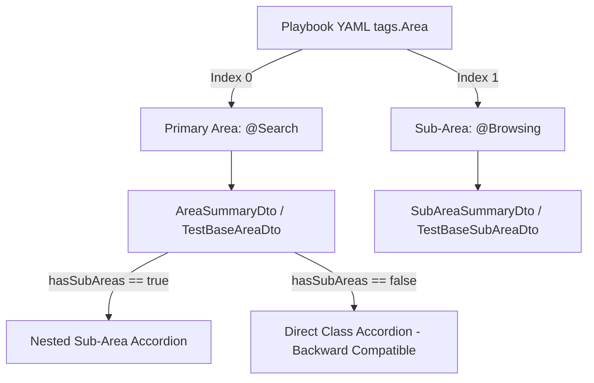

# [IDEA-20261105-1157] Deterministic Two-Level Nested Sub-Areas Hierarchy in Run Reports & Batch History

- **Status:** `Implemented`
- **Proposed:** 2026-11-05 11:57
- **Resolved:** 2026-11-05 12:15
- **Component:** `neodymium-core` / `aura-manager`
- **Category:** `Architecture & Core`
- **Author:** AI-generated: Antigravity / Xceptance GmbH 2026

## 1. Problem Statement & Motivation
Test variation playbooks frequently specify multi-dimensional domain tagging, such as:
```yaml
tags:
  Area:
    - Search
    - Browsing
```
When tests span multiple functional areas (e.g. searching products before browsing category facets), collapsing multiple area tags into either only the primary area or dynamically flipping the parent-child relationship based on run-scope counts introduces several critical defects:
1. **Historical Telemetry Disruption:** If the parent area flips dynamically (e.g. `Browsing > Search` in run A because run A ran 10 browsing tests, but `Search > Browsing` in run B because run B ran 20 search tests), time-series trend tracking (`TestBaseVariationEntity`, `BatchAreaTrendDto`) fractures across distinct identity keys.
2. **Loss of Granular Domain Organization:** Flattening all executions under the primary area loses the second-level specialization (e.g. `Search > Browsing` vs. `Search > Facets` vs. `Search > Autocomplete`).
3. **Disorienting Navigation:** Functional testers cannot isolate tests belonging to specific functional intersections without complex tag filtering.

## 2. Proposed Architecture & Design
Adopt a deterministic two-level hierarchy based strictly on the sequence order defined in the YAML tag list (`[ParentArea, SubArea]`):



### Components & Data Flow
1. **Interactive Console State (`InteractiveStateBuilder.java`):**
   - Extract `Index 0` as `areaName` (`@Search`).
   - Extract `Index 1` as `subArea` (`@Browsing`).
   - Write both to console execution JSON.
2. **Storage Ingestion (`LocalRunJsonStorageService.java`):**
   - Parse `subArea` from `node.path("subArea")` or index 1 of `tags.Area`.
   - Propagate `subArea` into `TestExecutionDto` and `run.json` metric maps.
3. **Report Aggregation (`AuraReportDataService.java`):**
   - In `buildAreaSummaries`, group executions under each primary area by their `subArea`.
   - If an area contains executions with a sub-area, create `SubAreaSummaryDto` instances.
   - Maintain full backward compatibility: `AreaSummaryDto.getTestClasses()` returns all test classes in the area.
4. **UI Presentation (`run-report.html`, `batch-history.html`, `report-manager.css`):**
   - If `area.hasSubAreas()`, render `.sub-area-group` accordions inside `.area-group-body`.
   - If `!area.hasSubAreas()`, render `.test-class-container` directly.

## 3. Expected Impact & Trade-offs
- **Benefits:**
  - **Deterministic & Predictable:** No flickering or flipping between runs. Historical metrics remain continuous and stable.
  - **100% Backward Compatible:** Single-area tests or legacy runs without sub-areas render identically without extra nesting.
  - **Granular Navigation:** Testers can inspect and filter specific sub-domains with clear hierarchical badge rollups.
- **Risks & Complexity:**
  - Additional CSS/JS for sub-area accordion toggle and badge filtering.
  - Minor increase in DTO footprint.

## 4. Open Questions & Alternatives Considered
- **Alternative 1 (Dynamic "Most Sub-Areas" Root Assignment):** Evaluated and rejected. Dynamically calculating which area has more sub-areas causes scope-dependent parent-child inversion, breaking historical consistency in multi-run aggregations.
- **Alternative 2 (Multi-Area Duplication):** Mirroring the execution under both `@Search` and `@Browsing` top-level cards was rejected because it inflates total execution count rollups and distorts run pass/fail percentages.

## 5. Implementation & Verification Details
- **Core Engine:**
  - `AuraFileService`: Ordered multi-tag extraction (`extractAreaTags`).
  - `InteractiveStateBuilder`: Populates `areaName` (Index 0) and `subArea` (Index 1) in runtime console state JSON.
- **Storage & Ingestion:**
  - `LocalRunJsonStorageService`: Ingests and serializes `subArea` alongside `areaName`.
  - `RunStorageSyncService`: Syncs `areaTag` and `subAreaTag` to `TestBaseVariationEntity`.
- **Reporting DTOs & Services:**
  - `SubAreaSummaryDto` & `TestBaseSubAreaDto`: Nested DTO models for sub-area grouping.
  - `AreaSummaryDto` & `TestBaseAreaDto`: Added `subAreas`, `getSubAreas()`, and `hasSubAreas()`.
  - `TestExecutionDto`: Fallback resolution of `areaName` and `subArea` from tags, localDataBindings, and JSON properties.
  - `AuraReportDataService`: Aggregates executions and batch variations into nested sub-areas while preserving flat top-level class lists for 100% backward compatibility.
- **UI & Interaction:**
  - `run-report.html` & `batch-history.html`: Extracted reusable test class fragments; renders nested `.sub-area-group` accordions when `area.hasSubAreas()`, otherwise renders flat.
  - `report-manager.css` & `report-manager.js`: Styles, toggle functions (`toggleSubAreaGroup`), and status badge filtering (`filterSubAreaByStatusBadge`) for nested sub-areas.
- **Automated Tests:**
  - `AuraFileServiceTest` & `InteractiveConsoleEngineTest`: 76 passed (neodymium-core).
  - `AreaSummaryDtoTest`, `TestExecutionDtoTest`, `AuraReportSubAreaHierarchyTest`: 16 passed (aura-manager).
