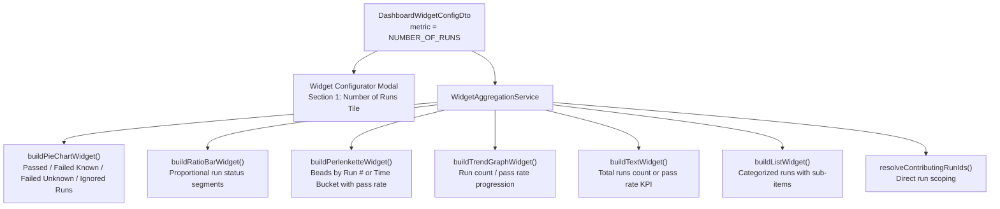

# [IDEA-20261106-1250] Dashboard Quantitative Metric Dimension: Number of Runs

- **Status:** `Implemented`
- **Proposed:** 2026-11-06 12:50
- **Resolved:** 2026-11-06 13:25
- **Component:** `aura-manager`
- **Category:** `Architecture & Core`
- **Author:** AI-generated: Gemini 3.8 Flash (High) / Xceptance Software Technologies GmbH 2026

## 1. Problem Statement & Motivation
Prior to this enhancement, Aura Manager supported `WidgetMetric.RUNS` and `WidgetPresentation.RUNS`, which rendered a dedicated 10-column, full-width tabular list of test execution runs. While valuable for linear run navigation, this was a fixed-layout presentation rather than an aggregatable quantitative metric dimension.

Users required the ability to track the volume, frequency, status breakdown, and pass rates of test execution runs across all interactive widget presentations (`PIE_CHART`, `RATIO_BAR`, `TREND_GRAPH`, `PERLENKETTE`, `TEXT`, `TEXT_WITH_SMALL_TREND`, `LIST`). Without a quantitative "Number of Runs" metric dimension:
1. Dashboards could not display a KPI counter of total runs executed over a timespan.
2. Teams could not visualize run pass rates as a donut chart or ratio bar.
3. Trend graphs could not plot run volume progression or run pass rate trends over time buckets.
4. Composite container cards could not combine run volume alongside test variation stability and AI usage.

## 2. Proposed Architecture & Design
Introduce `WidgetMetric.NUMBER_OF_RUNS` as an analytical metric dimension that aggregates test runs rather than test variations:

### Key Architectural Highlights:
1. **Metric & Aliasing:** Added `WidgetMetric.NUMBER_OF_RUNS` with natural aliases (`RUN_COUNT`, `RUNS_COUNT`, `NUM_RUNS`, `RUN_NUMBER`, `NUMBER_OF_RUN`, `EXECUTION_RUNS`, `RUN_VOLUME`, `RUN_FREQUENCY`, `NUMBER_OF_TEST_RUNS`).
2. **Value Formatting Default:** Automatically defaults `valueFormat` to `ABSOLUTE` (count of runs), while `PERCENT` represents the overall run pass rate.
3. **Execution Identity Override Suppression:** Suppressed `overrideExecutionIdentity` for `NUMBER_OF_RUNS` because execution identity tracks variation coordinates, not test execution runs.
4. **Flexible Sizing:** Enables quarter-width, half-width, and full-width layouts (unlike `RUNS` which is locked to `full`).
5. **Universal Aggregation Support:**
   - **Pie Chart & Ratio Bar:** Categorizes runs into Passed, Failed Known, Failed Unknown, and Ignored runs, with center KPI showing total runs (ABSOLUTE) or run pass rate (PERCENT).
   - **Trend Graph:** Plots cumulative/bucketed run counts or run pass rate progression with delta calculation (`+N runs vs start`).
   - **Perlenkette:** Renders beads representing each run or time bucket, complete with milestone labels, pass rates, test counts, and run links.
   - **Text & Small Trend:** Displays primary run KPI (e.g. `10 Runs` or `90% RUN PASS`) with sparkline trend geometry.
   - **List:** Itemizes run status groups with expandable sub-items pointing to individual runs.
   - **Contributing Runs & Containerization:** Implements direct run resolution in `resolveContributingRunIds()`, enabling containers with child widgets tracking run volume.

## 3. Expected Impact & Trade-offs
- **Benefits:**
  - Comprehensive analytical flexibility for CI/CD pipeline frequency, execution volume, and overall run pass rate tracking.
  - Full compatibility with all existing presentations, width presets, and container cards.
  - Zero regression risk to the tabular `WidgetMetric.RUNS` / `WidgetPresentation.RUNS`.
- **Risks & Complexity:**
  - Aggregation logic operates over `TestRunEntity` rather than `BatchLatestVariationDto`; handled cleanly via metric branching in `WidgetAggregationService`.

## 4. Open Questions & Alternatives Considered
- *Alternative Considered:* Overloading `WidgetMetric.RUNS` with presentation switches. Rejected because `WidgetMetric.RUNS` has distinct semantics (tabular 10-column history list locked to full width), whereas `WidgetMetric.NUMBER_OF_RUNS` is an analytical aggregate metric dimension supporting all visualizations and flexible widths.
