# [IDEA-20261106-1430] Tag Dimension String of Pearls Presentation

- **Status:** `Implemented`
- **Proposed:** 2026-11-06 14:30
- **Resolved:** 2026-11-06 14:40
- **Component:** `aura-manager`
- **Category:** `Architecture & Core`
- **Author:** Xceptance Software Technologies GmbH / Neodymium Team

## 1. Problem Statement & Motivation
Previously, the String of Pearls (`PERLENKETTE`) widget presentation on the Aura Manager Dashboard was strictly tied to chronological test execution runs (trending pass rates over time, runs, or hours/days/weeks). When users configured a widget with the `TAG` metric dimension (e.g. Browser, Environment, Locale, Device, or custom execution dimensions), `PERLENKETTE` was temporarily disabled (normalized to `PIE_CHART`) because the backend lacked categorical milestone aggregation for tags and would erroneously treat runs as the pearl milestone entities.

However, in multi-platform and multi-environment end-to-end testing, evaluating the health and pass rate across distinct tag values (such as across browsers: Chrome, Firefox, Safari, Edge; or environments: Staging, Production, Dev) along an undulating visual strand provides an immediate, intuitive, and aesthetically clear comparative view.

## 2. Proposed Architecture & Design

### 2.1 Categorical Milestone Pearls
Instead of chronological test runs or time buckets, each pearl along the strand represents a distinct tag value for the configured `tagKey` within the selected `pointScope` (e.g. "Latest Test Status" or "Last Run").

1. **Pass Rate Formulation:**
   $$\text{Pass Rate} = \frac{\text{Passed Clean} + \text{Passed Healed/AI} + \text{Fixed Clean} + \text{Fixed Healed/AI}}{\text{Total Tests with Tag Value}} \times 100.0$$
2. **Pearl Node Attributes:**
   - **Label (`bead.label`):** The tag value itself (e.g. "Chrome", "Firefox", "Safari").
   - **Main Value (`bead.valueFormatted`):** The calculated pass rate for that tag value (e.g. `90%`, `100%`) or ratio (`15/15` in `ABSOLUTE` format).
   - **Sub-label (`bead.timestampLabel`):** Test count volume (e.g. `10 tests`, `1 test`).
   - **Gauge Value (`bead.percentValue`):** Pass rate percentage driving the undulating vertical offset, gauge fill, and color classification.
   - **Dynamic Pill Badge (`bead.pillWidth`):** Dynamically computed pill width (`Math.max(radius * 1.9, label.length() * 7.2 + 16.0)`) preventing text clipping or overflow when tag values are longer words.
   - **Rich Details Map:** Accessible via tooltip popover showing Tag key/value, Pass Rate, Total Tests, Passed, Fixed, Known Fail, Unknown Fail, and Ignored.

### 2.2 Sizing and Ordering
- Pearls are sorted by test volume descending, with deterministic alphabetical tie-breaking, ensuring that the highest-volume platforms or tag values appear prominently first.
- The strand clamps to the top `maxShells` (e.g. 5 beads for half-width, 10 for full-width) to preserve visual clarity without strand congestion.

### 2.3 UI & Configuration Symmetry
- In the widget configurator modal and JavaScript controllers, `PERLENKETTE` is fully selectable when `metric == TAG`.
- Irrelevant chronological trend options (`widgetTrendModeSection`, trend badges like "Daily", "By Runs") and the chronological "LATEST" badge group are suppressed when `metric == TAG`.
- The Target Point / Time Scope (`widgetPointScopeSection`) is displayed and evaluated, allowing users to inspect either "Latest Test Status" or scoped runs.

```mermaid
flowchart LR
    A["Widget Config (TAG + PERLENKETTE)"] --> B["WidgetAggregationService"]
    B --> C["Filter by PointScope"]
    C --> D["Group Variations by Tag Value"]
    D --> E["Calculate Pass Rate & Status per Tag Value"]
    E --> F["Sort by Test Volume Descending"]
    F --> G["Build PerlenketteBeadDto with Dynamic Pill Width"]
    G --> H["Render Dashboard Widget SVG Strand"]
```

## 3. Expected Impact & Trade-offs
- **Benefits:**
  - Rich, visually engaging comparative health overview across browsers, operating systems, locales, or custom execution dimensions.
  - Consistent presentation design language across the dashboard.
  - Zero disruption to existing chronological run-based String of Pearls widgets for other metrics (`STATUS`, `BUGS`, `COSTS`, `NUMBER_OF_RUNS`).
- **Risks & Edge Cases:**
  - Long tag value names could clip in fixed SVG circles -> Mitigated by dynamic `bead.pillWidth` and label truncation.
  - Tag dimensions with no data -> Gracefully renders standard empty message `"No tag data available"`.

## 4. Open Questions & Alternatives Considered
- *Alternative:* Displaying raw counts inside pearls instead of pass rate -> Rejected because String of Pearls is primarily an undulating health gauge; pass rate percentage maps naturally to the pearl elevation and color polarity spectrum. Raw test counts are clearly displayed in the sub-label and tooltip details.
