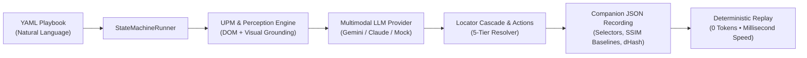

[](https://mvnrepository.com/artifact/com.xceptance/neodymium-library)

# Neodymium Core

**Neodymium Core** (`neodymium-core`) is the foundational runtime engine of the Neodymium ecosystem, hosting **Neodymium AI** and the modern `org.neodymium.*` package namespace.

It provides the AI perception cascade, Universal Page Model (UPM), multimodal LLM orchestration, perceptual visual verification, autonomous self-healing, and companion recording/replay infrastructure that turns natural language playbooks into millisecond-fast, deterministic offline test executions.

---

## Architectural Highlights



### 1. Neodymium AI Engine (`org.neodymium.ai.*`)
- **Natural Language Playbooks**: Execute `.yaml` playbooks or inline test definitions using declarative steps (`open:`, `click:`, `type:`, `assert:`, `_include:`).
- **Universal Page Model (UPM)**: Extracts semantic, spatial, and accessibility trees from browser DOM state to present clean representations to multimodal LLMs.
- **Multimodal LLM Integration**: Pluggable providers supporting Google Gemini (Live API / SDK) and Claude, with outbound secret masking and in-memory LLM response caching (`@AiLlmCache`).

### 2. 5-Tier Locator Cascade Resolver
Resolves elements with extreme resilience against layout and DOM drift:
1. **Primary Recorded Selector**: Exact CSS/XPath from initial recording.
2. **Recorded Fallback Selectors**: Alternative candidate locators recorded during observation.
3. **Semantic & Accessibility Match**: ARIA roles, labels, text content, and placeholder semantics.
4. **Spatial Proximity (`DomFeatureVector`)**: Vector distance and bounding-box geometry matching.
5. **Multimodal LLM Self-Healing**: Dynamic runtime re-observation when prior tiers fail, persisting repaired selectors to companion recordings.

### 3. Visual Validation & SSIM Baselines
- **Perceptual Visual Hashing (dHash)**: Computes fast visual hashes to detect significant layout or image regressions.
- **SSIM Baseline Verification**: Structural similarity metric comparisons ensuring element and viewport styling integrity.

### 4. Modern JUnit 5 Integration (`org.neodymium.junit5.*`)
- Seamless lifecycle extensions providing `@NeodymiumAiTest`, `@AiMode`, `@AiPlaybook`, `@AiInlinePlaybook`, and dynamic parameter injection.

---

## Getting Started

### 1. Maven Dependency

Add `neodymium-core` to your project dependencies:

```xml
<dependency>
    <groupId>com.xceptance</groupId>
    <artifactId>neodymium-core</artifactId>
    <version>6.0.0-BETA</version>
</dependency>
```

### 2. Writing an AI Playbook Test

```java
package org.neodymium.ai.example;

import org.neodymium.ai.config.ExecutionMode;
import org.neodymium.ai.junit.AiInlinePlaybook;
import org.neodymium.ai.junit.AiMode;
import org.neodymium.ai.junit.NeodymiumAiTest;
import org.neodymium.ai.session.AiSession;

@NeodymiumAiTest
public class StorefrontPlaybookTest
{
    @AiMode(ExecutionMode.REPLAY_WITH_HEALING)
    @AiInlinePlaybook("""
        name: Search and Validate Product
        steps:
          - open: "https://my-store.local"
          - type: "Search query" into: "input[name='query']"
          - click: "button[type='submit']"
          - assert: "Search results are displayed"
        """)
    public void testSearchFlow(final AiSession session)
    {
        // Handled automatically by NeodymiumAiRunner
    }
}
```

---

## Building & Unit Testing

Run fast in-memory unit tests (no browser, no external server, zero LLM tokens):

```bash
mvn test -pl neodymium-core -Punit-tests
```

---

## Further Reading

* [Comprehensive Neodymium Documentation](../doc/DOCUMENTATION.md)
* [Neodymium AI Redesign V2 Specifications](../doc/redesign-v2/architecture.md)

---

## License

`neodymium-core` is dual-licensed under the **GNU Affero General Public License v3 (AGPLv3)** and a **Commercial License**:

* **Community Edition (GNU AGPLv3)**: Free for development, testing, and internal applications under the terms of the GNU Affero General Public License v3.
* **Commercial Edition**: For commercial SaaS offerings, proprietary bundling, or deployments without AGPLv3 copyleft/network-disclosure requirements, a commercial license is required.

For inquiries and commercial licensing, contact **[support@xceptance.com](mailto:support@xceptance.com)**.

---

*This document was generated with the assistance of AI and reviewed by Xceptance experts.*
